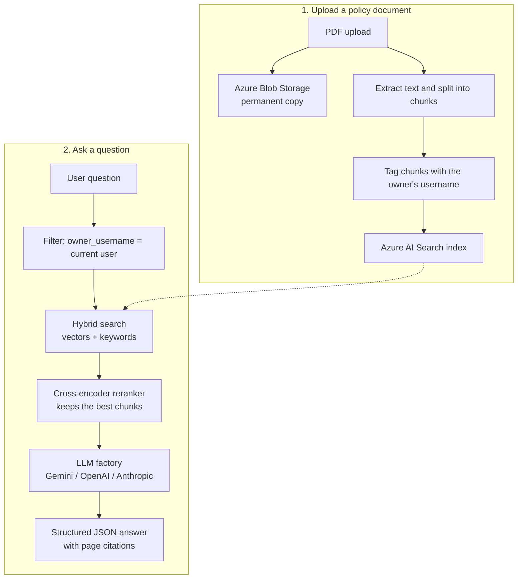

# Expense Tracker with AI Policy Assistant

A multi-user expense tracker with an AI assistant that answers questions from company policy documents and checks new expenses against those policies. Built with **FastAPI**, **LangChain / LangGraph**, **PostgreSQL**, **Azure Blob Storage** and **Azure AI Search**.

Each user logs in with a JWT token and only ever sees their own documents and expenses.

---


## How it works



1. **Storage:** policy PDFs are saved to Azure Blob Storage.
2. **Ingestion:** text is split into chunks, tagged with the uploading user's name (`owner_username`), and indexed in Azure AI Search.
3. **Retrieval:** each question runs a hybrid search (vector + keyword), restricted by an `owner_username` filter so users cannot see each other's documents.
4. **Reranking:** a cross-encoder reranker keeps only the most relevant chunks, which reduces noise and unsupported answers.
5. **Answer:** the chunks go to the chosen LLM, and the answer is validated against a Pydantic schema, with citations kept separate from the answer text.
6. **Compliance check:** when an expense is added, a background step checks it against the stored policies.

---

## Features

- **Switchable LLM provider:** change between Google Gemini, OpenAI and Anthropic with one environment variable, no code changes.
- **Per-user data separation:** JWT login, with every search filtered by the logged-in user.
- **Rate limiting:** a PostgreSQL-backed token bucket (burst of 2, refill 0.1/second) that works across multiple server instances. Requests over the limit get `429 Too Many Requests`.
- **Prompt-injection filter:** blocks inputs such as "ignore previous instructions" before they reach the model.
- **Request tracing:** each request gets an ID with timing, estimated token usage and estimated cost.
- **Startup schema sync:** adds missing database columns (`role`, `is_active`, `category`) on boot so older databases keep working.
- **Automated security tests:** a script that attacks the API with bad input, missing login and request floods (see below).
- **CI:** GitHub Actions workflow in `.github/workflows`.

---

## Project structure

```
├── .github/workflows/          # CI pipeline
├── app/
│   ├── database/connection.py  # Database engine and sessions
│   ├── models/                 # SQLAlchemy models (expense, user)
│   ├── routers/
│   │   ├── auth.py             # JWT login
│   │   ├── expenses.py         # Expense logging + policy compliance check
│   │   └── search.py           # Policy Q&A endpoints
│   ├── schemas/                # Pydantic schemas and LangGraph state
│   ├── services/
│   │   ├── document_processor.py   # Blob upload + text chunking
│   │   ├── model_factory.py        # LLM provider switch
│   │   ├── observability.py        # Timing, token and cost tracking
│   │   ├── security_guardrails.py  # Input filter, size limits, rate limiter
│   │   └── vector_store.py         # Azure AI Search connection
│   └── main.py                 # App startup
├── knowledge_docs/             # Sample policy documents
├── tests/pentest_suite.py      # Security test script
├── Dockerfile
├── compose.yaml
├── .env.example                # Copy to .env and fill in
└── requirements.txt
```

---

## Setup

### 1. Clone and install

```bash
git clone https://github.com/Gallaxz-lab/multi-user-Expense-Tracker-API.git
cd multi-user-Expense-Tracker-API
python -m venv venv
source venv/Scripts/activate   # Windows (Git Bash). On Mac/Linux: source venv/bin/activate
pip install -r requirements.txt
```

### 2. Configure `.env`

Copy `.env.example` to `.env` and fill in your own values:

```
DB_USER="postgres"
DB_PASSWORD="your_database_password"
DB_HOST="localhost"
DB_PORT=5432
DB_NAME="expense_tracker"

SECRET_KEY="a_long_random_secret"
ALGORITHM="HS256"
ACCESS_TOKEN_EXPIRE_MINUTES=60

LLM_PROVIDER="gemini"          # gemini | openai | anthropic
GEMINI_API_KEY="your_key"

AZURE_STORAGE_CONNECTION_STRING="your_connection_string"
AZURE_STORAGE_CONTAINER_NAME="user-policy-documents"

AZURE_SEARCH_ENDPOINT="https://<your-service-name>.search.windows.net"
AZURE_SEARCH_API_KEY="your_search_admin_key"
AZURE_SEARCH_INDEX_NAME="enterprise-knowledge-base"
```

Never commit your real `.env` file.

### 3. Run

```bash
uvicorn app.main:app --reload
```

Open **http://127.0.0.1:8000/docs** for the interactive API page (Swagger UI).

---

## Security tests

```bash
python tests/pentest_suite.py
```

The script checks that the API handles these cases safely:

- **Empty or blank question:** returns `422`, not a server crash.
- **Prompt-injection attempt:** returns `400`.
- **Missing login token:** returns `401`.
- **Rapid repeated requests:** returns `429`.

---

## Status

Working project built for learning and portfolio purposes. It has not been deployed for real users or reviewed by a security professional.
